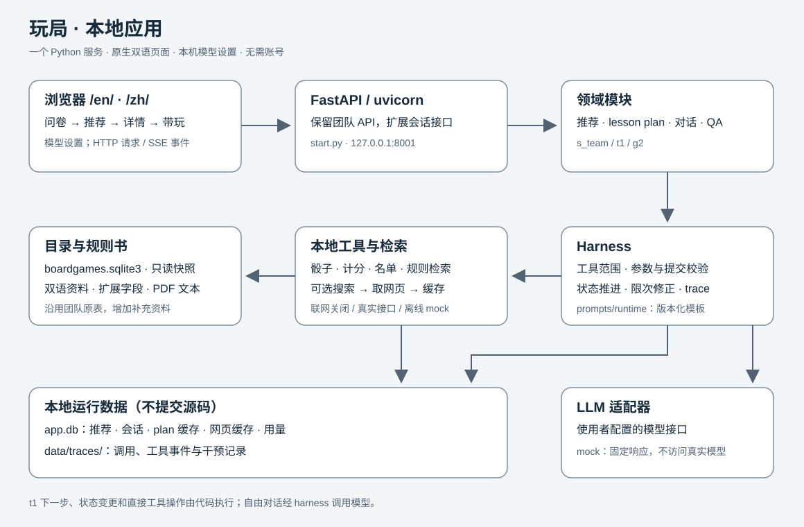

# 本地应用架构

一个 uvicorn 进程同时提供原生网页和 FastAPI 接口。浏览器默认访问 `127.0.0.1:8001`，`DEPLOY_MODE=local` 下直接使用，并显示模型设置页。

| 模块 | 职责 |
|---|---|
| `start.py` | 启动服务，就绪后打开浏览器；缺少目录库时给出构建命令。 |
| `frontend/en`、`zh`、`shared` | 问卷、推荐、详情、带玩和设置；用普通 HTTP 与 SSE 更新页面。 |
| `backend/server.py`、`rules_api.py` | 保留团队接口与页面入口；返回目录推荐与规则讲解。 |
| `backend/api.py`、`settings_api.py` | 会话、分步推进、聊天、工具及本机模型配置。 |
| `backend/recommend` | 执行人数、主持、道具硬约束；保留团队 `s_team` 排序，支持排除已展示游戏与补充偏好。 |
| `backend/tutor`、`qa` | 生成 lesson plan、维护会话、调用工具与来源标注；默认 `t1 / g2`。 |
| `backend/harness` | 按阶段开放工具，校验参数与提交，限次修正，记录调用与干预。 |
| `backend/llm.py`、`config.py` | 读取使用者配置，适配模型接口；mock 模式不访问真实模型。 |
| `backend/catalog.py`、`rulebook.py` | 从目录库读取双语资料；规则书全文或 BM25 检索。 |
| `backend/tutor/web.py` | 搜索、取网页和按游戏缓存内容；mock 搜索仅返回固定示例。 |
| `backend/appdb.py` | 保存推荐、会话、plan 缓存、网页缓存及用量，和只读目录库分开。 |
| `prompts/runtime` | 有版本的提示词、工具说明与校验消息；模板严格检查缺失变量。 |

## 一次完整会话

1. 浏览器提交问卷到 `POST /recommend`：实际人数、主持、道具、场合、氛围、可选补充偏好和语言。代码先过滤不可玩的游戏，`s_team` 依据团队原排序选候选，再经 harness 请求模型重排。模型或格式失败时可返回目录推荐，页面仍显示最多三张卡片。
2. 结果同时返回 `rid`，推荐记录保存在 `app.db`。换一批或补充偏好调用 `/recommend/refine`，沿用问卷并排除已展示 ID。
3. 打开卡片进入详情，立即显示目录规则，再调用 `/rules/explain` 生成当前语言的讲解。该调用使用迁移后的团队提示词并记录 trace；失败时目录资料仍可读。
4. 点「开始带玩」，填或跳过名字，`POST /api/sessions` 建立会话。`t1` 先查相同游戏、语言、人数、profile 与提示词指纹的 plan 缓存，未命中才生成。模型通过 `submit_lesson_plan` 提交结构化计划，Pydantic 与业务校验通过后保存。
5. 对没有本地规则书的游戏，开启搜索时，plan 阶段可以调用 `web_search` → `fetch_page`。harness 执行工具，网页内容按游戏写入 `web_cache`；模型获得工具结果，再提交计划。后续可通过 `lookup_rulebook` 检索缓存。浏览器收到 SSE 工具事件并展示来源。离线演示用 `SEARCH_PROVIDER=mock` 走同一条路径，但不会联网，示例页面不是实际游戏规则证据。
6. 带玩页展示当前步骤及 `[[dataset]]`、`[[rulebook]]`、`[[general]]`、`[[web]]` 标签。`t1` 的「下一步」和阶段跳转由代码推进；骰子、记分、玩家名单等也由代码维护。自由提问才进入对话循环，工具结果作为 `tool` 消息交回模型。
7. 会话状态、消息和工具结果持久化到 `app.db`，刷新后可以恢复；模型调用 trace 写入 `data/traces/`。两者均为本地运行数据，不纳入产品源码提交。

## 保留与边界

团队的 `/recommend`、`/rules/explain`、`/games`、`/games/{id}/core-rules`、`/health` 以及原目录字段保留。`backend/model_api.py` 保持原文件，新调用统一经过 harness。模型名、密钥和兼容接口地址由本机设置提供；不在源码里固定模型。来源标签表示内容所声明的来源类别，不保证内容自动正确；本次验收确认 mock 流程可运行，不验证真实模型或搜索质量。
