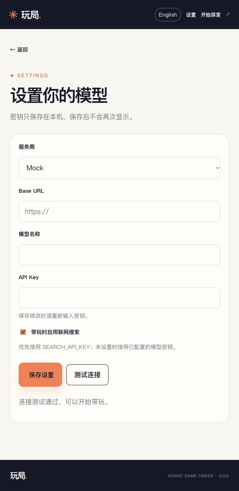

# 本地冷启动验收

2026-11-10，macOS 27.0 / Apple Silicon，Python 3.12.16。按负责人最新要求，仅验收本地使用，保留模型设置页，无账号步骤；未使用 Docker。

## 环境与操作

产品副本从团队 `main` 的 `fe1084d` 开始，只加入产品文件。随后用 `git clone --no-local --no-tags --single-branch --branch agent-harness <产品副本> <全新目录>` 重新克隆，在全新目录创建独立 `.venv`，未复用原环境的 site-packages，执行 README 的 `python -m pip install -r requirements.txt`。

复制 `.env.example` 为 `.env`，仅把 `MODEL_PROVIDER` 改为 `mock`，`SEARCH_PROVIDER` 改为 `mock`，保持 `DEPLOY_MODE=local` 和 `s_team / t1 / g2`。在全新克隆里执行 `python start.py --port 8002`，用真实浏览器操作网页。

自动开浏览器的回调在服务就绪后收到 `http://127.0.0.1:8002/`；回调当时请求 `/health` 返回 200。测试回调用于确认启动时序，页面点击另由浏览器完成。

## 验收清单

| 检查 | 实际结果 |
|---|---|
| 仅运行依赖安装、原有目录库可用 | 通过；无需重建目录库或另开数据库服务 |
| 本地直接进入网页，无账号登录 | 通过；`/zh/`、`/en/` 首页可直接打开 |
| 中文：首页 → 问卷 → 推荐 → 详情 → 带玩 | 通过；4 人、无主持、通用用品、朋友聚会、轻松聊天、补充偏好；首款为纸牌帮 |
| 英文同一路径 | 通过；相同硬条件，首款为 The Gang；目录字段与页面为英文 |
| 带玩「下一步」 | 通过；中文、英文会话均从 index 0 推进至 1，显示 Step 2 |
| 骰子与计分工具 | 通过；中文页面掷骰显示 1d6 结果，玩家 1 的分数从 0 变为 1 |
| 模型设置页 | 通过；Mock、空模型名、空密钥可打开；「测试连接」显示连接测试通过 |
| 搜索、取网页与缓存路径 | 通过离线模拟；首个 plan trace 含 `web_search`、`fetch_page`、`submit_lesson_plan`，本地网页缓存新增 1 条 |
| 来源展示 | 通过；提问后显示规则检索卡、Web / 网络徽标及 Example game rules 链接 |
| 页面刷新恢复 | 通过；英文页面刷新后恢复 The Gang、Step 2、原提问与来源链接 |
| 产品自动测试 | 全新虚拟环境安装开发依赖后，`python -m pytest -q`：143 passed（9.60 秒） |
| 静态检查 | `ruff check backend tests start.py`：通过 |
| 架构图 | 已导出 `assets/architecture.svg`，SVG XML 可解析 |

## 发现与修复

- 团队原 `start.py` 没有端口参数或自动开页。本次补上 `--host`、`--port`、`--no-browser`，默认仍为 `127.0.0.1:8001`，并在缺少目录库时提示构建命令。
- 缺少完整的空白配置示例，已添加 `.env.example` 及逐项中文注释。
- 产品文件筛选最初遗漏团队提示词回归与搜索兼容测试的参考 fixtures；已补齐后重跑全部 143 项产品测试，无失败。未修改原冻结目录或原始记录。
- plan 生成阶段的搜索调用记录在 trace；页面中展示的卡片是随后的缓存检索。演示文档已按实际行为描述。

## 验证范围

以上是本机安装、页面与接口行为验收。mock 使用固定内容，不证明真实模型生成质量、中文回复质量或真实搜索接口可用性。Windows 和 Python 3.11 / 3.13 / 3.14 未在目标机器实测；保留原 Windows `.runtime` 查找逻辑。本次未发起真实模型、真实搜索或账号部署测试。

[英文带玩与恢复截图](assets/local-play-en.jpg)
